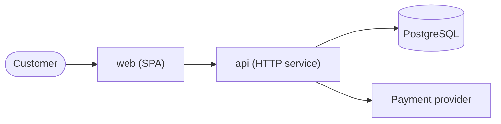
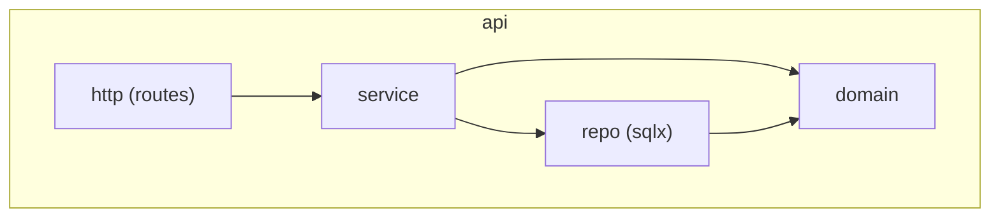
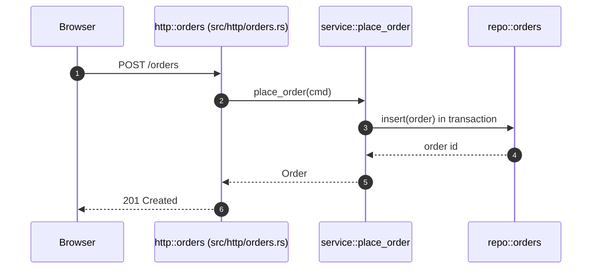

# Architecture documentation reference

## Document template

Drop sections the system does not need; keep the order.

````markdown
# Architecture: <system>

_Last verified against commit <short sha> on <date>. Sources are cited per section._
_Update when: a deployable, external system or module boundary is added or removed._

## 1. Context
What the system does and for whom, in three to five sentences. External actors and systems.
Sources: README.md, src/main.rs



## 2. Deployables
| Name | Technology | Responsibility | Source |
| --- | --- | --- | --- |
| api | Rust, axum | HTTP API, business rules | crates/api/Cargo.toml |

## 3. Modules
Per deployable: a table (module, responsibility, public interface, source) and a dependency diagram.
State the dependency rule ("domain depends on nothing; adapters depend on domain") and any violations found.

## 4. Key flows
One subsection per flow: a sequence diagram plus numbered steps with file:line.

## 5. Data
Stores, which module owns each table or collection, where migrations live, retention rules if defined in code.

## 6. Cross-cutting concerns
Configuration, authentication and authorization, error handling, logging and metrics, background jobs.

## 7. Decisions
Links to ADRs. Proposed ADRs for significant decisions found in code without a record.

## 8. Inferred, unverified and open questions
Everything marked "Inferred - please verify" collected in one list, plus unknowns.
````

## Diagram conventions

- Use plain `flowchart` (with `subgraph` for boundaries) for context, deployables and modules. It renders in
  GitHub, GitLab and most Markdown viewers; Mermaid's C4 diagram types are less widely supported.
- Use real names from the code as node ids or labels so a reader can search for them.
- Quote labels that contain spaces, parentheses or punctuation: `api["api (HTTP service)"]`.
- Shapes: `([...])` people, `[...]` services and modules, `[(...)]` data stores, `{{...}}` queues if used
  consistently; explain non-obvious shapes in a one-line legend.
- Arrows point in the direction of the call or dependency; label them with the protocol or the operation when it
  is not obvious (`web -->|HTTPS| api`, `api -->|enqueue| jobs`).
- About fifteen nodes per diagram. Split by boundary (one diagram per deployable) rather than shrinking text.

### Module dependencies



### Sequence diagram for a flow



Pair each diagram with numbered steps that cite code, e.g. "3. `service::place_order` validates stock
(src/service/orders.rs:41) and inserts inside one transaction (src/repo/orders.rs:88)."

## Marking inference

Use a blockquote directly where the claim appears:

```markdown
> Inferred - please verify: the api runs as two replicas behind a load balancer (based on the health check
> in src/http/health.rs and the absence of local state; no deployment manifest in the repository).
```

## ADR template (proposed, written from code)

Use the project's existing ADR format and numbering when it has one; otherwise this shape (DOC-* has the ADR rule).

```markdown
# ADR-<n>: <decision in a short phrase>

Status: Proposed
Date: <date>

## Context
The forces at play, as far as the repository shows them. Cite files.

## Decision
What the code does (e.g. "All writes go through the service layer; HTTP handlers never use the repository
directly" - src/http/*.rs).

## Rationale
Unknown - please fill in. (Or the cited source: commit, issue, doc.)

## Consequences
Observable effects: what is easier, what is harder, which constraints follow.

## Alternatives considered
Unknown unless a source records them.
```

## Evidence sources, strongest first

1. Code paths actually executed from an entry point (traced).
2. Build and deployment configuration (manifests, Dockerfiles, CI jobs).
3. Tests (they show intended behaviour and boundaries).
4. Migrations and schema files.
5. Commit messages, ADRs, issues linked from commits.
6. README and existing docs (verify against 1-4; they drift).
7. Directory and file names (weakest; never sufficient alone).
